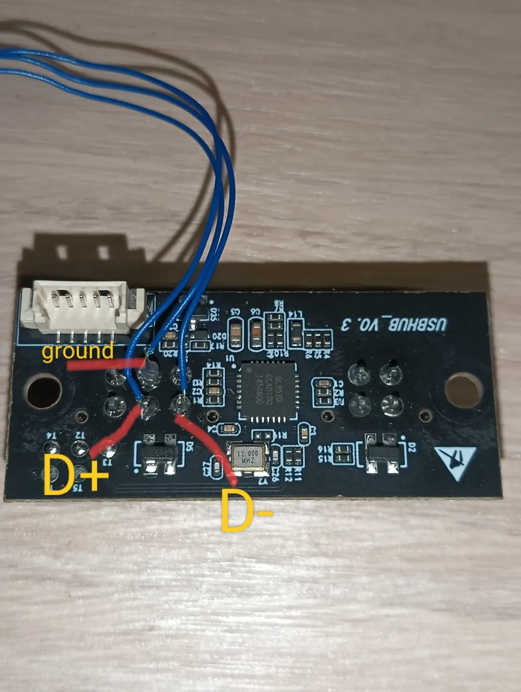

# CosmoACE Integration (Advanced)

Detailed specs, TODOs, pinouts, manual install, and USB bring-up notes.

For a plain-language install guide, start with the main [README](README.md).

---

CosmoACE is a lightweight Anycubic ACE Pro add-on for CosmOS / OpenCentauri.

This repo is intentionally focused on:
- CosmOS / OpenCentauri
- OrcaSlicer and PrusaSlicer-style forks
- lightweight printer-side integration

It does not target generic Klipper distributions or every slicer.

## What It Does

CosmoACE installs:
- a Python CLI + shell wrapper Klipper can call
- an optional USB watch script for rear-AMS bring-up (`ace-usb-watch.sh`)
- a Klipper macro set for blocking start, toolchange, and end-print flows
- an optional heartbeat init script (**off by default** — too heavy for ~112MB CosmOS)

The supported print flow is:
1. Load the selected slot to the hub sensor when one is configured.
2. Continue until the toolhead sensor triggers, then seat the filament in the extruder.
3. Sync-load, purge, wipe, and start printing.
4. On toolchange, cut, unload from the toolhead, clear the hub (sensor-confirmed or
   fixed-distance), load the next slot, purge, wipe, and resume.

## TODO

The CC1 Canvas toolhead-sensor migration and optional-hub flow are implemented. The
remaining work is configuration, physical validation, and cleanup.

### Configuration and calibration

- [ ] Measure the real hub-sensor-to-toolhead distance and tighten `load_to_toolhead_search_mm`
      from the current 900mm guess.
- [ ] Tune `load_past_toolhead_mm` (currently 15mm) so the filament reaches the extruder gears
      without pushing into the melt zone cold.
- [ ] Calibrate `unload_past_hub_mm` and `load_to_toolhead_full_search_mm` by running
      `_ACE_BLIND_CLEAR_HUB` (or `ACE_BLIND_CLEAR_HUB` if the nohub panel include is
      enabled) while the hub sensor is still installed; the macro cross-checks the blind
      distance against the hub sensor whenever one is present.

### Validation

- [ ] Bench-test start, toolchange, and end-print on the Canvas toolhead.
- [ ] Test both supported configurations: toolhead-only and hub plus toolhead.
- [ ] Verify the ACE reconnect and startup announcement after a full printer power cycle.
- [ ] Stabilize Centauri rear-AMS USB (disconnect / `-71` flaps). ACE may
      enumerate (`28e9`) then drop every few seconds — that is harness SI, not
      CosmoACE software. Heartbeat stays off by default on 112MB CosmOS.

### Cleanup and follow-up

- [ ] Use `toolhead_cutter_detection` to confirm the cut engaged in `_ACE_CUT_FILAMENT`.
- [ ] Remove obsolete blind-feed compatibility code after deciding whether pre-Canvas
      toolheads still need support.
- [ ] Consolidate repeated hub/toolhead sensor detection in `ace_macros.cfg`.
- [ ] Add automated tests for `ace_macros_nohub_panel.cfg` and connection retries.

## Requirements
An Elegoo Centauri Carbon and an Anycubic ACE Pro

- A working CosmOS installation
- SSH access as `root`
- Klipper `gcode_shell_command`
- A configured `filament_switch_sensor`
- Printer-side tray / wipe / pause macros already present:
  - `MOVE_TO_TRAY`
  - `M729`
  - `PAUSE_BASE`
  - `RESUME`

Set your gcode in OrcaSlicer:
[OrcaSlicer G-Code Guide](docs/ORCA_GCODE.md)

USB link stability, by-id pinning, and the on-printer harness:
[ACE USB Stability](docs/ACE_USB_STABILITY.md)

## Install

1. Copy this repository to a USB drive.
2. SSH into the printer as `root` (password: `OpenCentauri`).
3. Run:

```sh
# Navigate to your USB mount (usually /user-resource/.tmp/ on Centauri)
cd /user-resource/.tmp/cosmoace-integration
chmod +x install.sh uninstall.sh
./install.sh
```

### Manual Install (If script fails)
If you prefer to install manually or the script encounters issues with your specific firmware version:

1. **Remount as Read-Write:**
   ```sh
   mount -o remount,rw /
   ```
2. **Create Directories:**
   ```sh
   mkdir -p /user-resource/ace-addon
   mkdir -p /etc/klipper/config/klipper-readonly
   ```
3. **Copy Files:**
   ```sh
   cp files/ace-addon.py /user-resource/ace-addon/
   cp files/ace-command.sh /user-resource/ace-addon/
   cp files/ace-usb-watch.sh /user-resource/ace-addon/
   cp files/ace-addon.conf /user-resource/ace-addon/
   cp files/ace-addon.init /etc/init.d/ace-addon
   chmod +x /etc/init.d/ace-addon
   cp files/ace_macros.cfg /etc/klipper/config/ace-addon.cfg
   # Hub-less only: expose ACE_BLIND_CLEAR_HUB on the Mainsail panel
   # cp files/ace_macros_nohub_panel.cfg /etc/klipper/config/
   ```
4. **Set Permissions & Symlink:**
   ```sh
   chmod +x /user-resource/ace-addon/*.sh /user-resource/ace-addon/*.py
   ln -sfn /etc/klipper/config/ace-addon.cfg /etc/klipper/config/klipper-readonly/ace-addon.cfg
   ```
   If you installed `ace_macros_nohub_panel.cfg` (hub-less), add this to `ace-addon.cfg`
   (or your printer config) so the panel button is loaded — **do not** add it when a
   hub sensor is enabled, or the nohub button will show up in Mainsail:
   ```cfg
   [include /etc/klipper/config/ace_macros_nohub_panel.cfg]
   ```
5. **Remount as Read-Only:**
   ```sh
   mount -o remount,ro /
   ```
6. **Restart Klipper** (do **not** start `ace-addon` heartbeat by default on CosmOS):
   ```sh
   service klipper restart
   # Optional USB bring-up log:
   # /user-resource/ace-addon/ace-usb-watch.sh 5
   ```

## Hardware
You will need this filament hub adapter which mounts to the Carbon Centauri's run-out sensor:
[Filament Hub Adapter (Printables)](https://www.printables.com/model/1662192-centauri-carbon-multi-material-filament-hub-4-colo)

### ACE Cable (rear AMS / MMU port)

This project targets the Centauri Carbon **rear AMS / MMU port**.

There are two different connectors in this path — do not confuse them:

| Connector | Pins | Where |
| --- | ---: | --- |
| External rear port (chassis) | **4-pin** | What you plug the ACE signal cable into |
| Board connector (mainboard side) | **5-pin** | Internal harness from the rear port to the board |

The ACE modification is done on the **board connector / harness**, not by inventing a
5-pin external rear jack.

#### Required ACE signal cable

> [!WARNING]
> You must use the ACE Pro's **4-pin-to-6-pin signal cable**. The **6-pin end plugs
> into the ACE Pro**. The **4-pin end plugs into the Centauri's external rear AMS
> port**. A 4-pin-to-4-pin cable does not connect to the ACE Pro's USB interface.

The 4-pin end of the ACE signal cable uses this pinout
([DuckACE](https://github.com/utkabobr/DuckACE) /
[ValgACE](https://github.com/agrloki/ValgACE)):

| Cable pin | Signal |
| ---: | --- |
| 1 | VCC / 5V — leave disconnected at the ACE end of any DIY adapter |
| 2 | GND |
| 3 | D- |
| 4 | D+ |

On a normal USB host (Pi, Voron, CosmOS **front** USB), map these straight across and
leave VCC off. No swap.

#### Rear-AMS bring-up ladder

Software can only talk to the ACE after Linux enumerates it. Climb this ladder on
the **rear AMS port only**:

1. **Power / seat** — ACE 24V brick on, panel alive, 6-pin seated, 4-pin in the rear
   chassis port.
2. **Enumerate** — `lsusb` shows VID `28e9` (GDMicroelectronics ACE).
3. **TTY** — a **second** `/dev/ttyACM*` appears beside the Klipper MCU.
4. **RPC** — `ACE_CHECK` / `ace-command.sh health` returns `ok: true`.
5. **Stay up** — still present after 10+ minutes of idle (no disconnect every few
   seconds).

While debugging, run the lightweight watcher (manual, not a boot service):

```sh
/user-resource/ace-addon/ace-usb-watch.sh 5
# logs to /board-resource/ace-usb.log
```

#### Stability experiments

Full write-up of by-id pinning, knobs, and measured Centauri numbers:
[docs/ACE_USB_STABILITY.md](docs/ACE_USB_STABILITY.md).

`ace-stability-test.sh` quantifies the link instead of guessing (manual start
only, same resource rules as the watcher). Results append to
`/board-resource/ace-stability.log`:

```sh
/user-resource/ace-addon/ace-stability-test.sh all      # full sweep (~3 min)
/user-resource/ace-addon/ace-stability-test.sh flap 60  # disconnects per minute
/user-resource/ace-addon/ace-stability-test.sh rpc 20   # health success rate
/user-resource/ace-addon/ace-stability-test.sh paths    # raw tty vs by-id vs by-path
/user-resource/ace-addon/ace-stability-test.sh settle   # sweep connect_settle_s
```

How to read it: `flap` is the hardware baseline (a ferrite/cable/ground fix
should lower it); `rpc` is what the macros actually experience; `paths` should
show by-id matching or beating the raw tty — if raw ever loses, the node
renumbered mid-test and by-id is doing its job; `settle` picks the smallest
`connect_settle_s` whose ok-rate matches the best one (set it in
`ace-addon.conf`).

**Symptom cheat sheet**

| What you see | Likely cause |
| --- | --- |
| No `28e9` in `lsusb`, only Klipper MCU | ACE unpowered, unplugged, or harness open |
| `28e9` appears then `USB disconnect` every ~3s | Rear AMS signal integrity (strain, polarity, ground) |
| `error -32` / false low-speed device | Data lines **not** swapped on the board harness |
| `error -71` during reconnect storms | Same SI / cable path as disconnect flaps |
| Health OK, then idle dryer/link dies later | Idle drop — occasional `ACE_CHECK`, not a RAM-heavy heartbeat |

While the link still flaps, CosmoACE rides it out ACEPRO-style: every call gets
3 protocol attempts with a growing backoff (0.25s → 2s) so a retry lands in the
next USB up-window, and motion commands only go out once, after a retried
`get_status` probe proves the link is alive.

To pin the path in `ace-addon.conf`, use the **by-id alias** (health prints it
as `pin_hint`) — its name survives ttyACM renumbering across flaps, so it is
safe to pin even while the link is still flaky:

```ini
serial_port = /dev/serial/by-id/usb-ANYCUBIC_ACE_1-if00
```

Never pin `/dev/ttyACM1` — that node renumbers on every reconnect. The default
config pins the by-id alias above; only fall back to `serial_port = auto` if
the by-id name differs on your unit (check health's `pin_hint`).

#### Board connector pinout (Centauri Carbon, 5-pin)

The internal board-side connector is **5-pin**:

| Board pin | Marking | Signal | Notes |
| ---: | --- | --- | --- |
| 1 | 24V | +24V | 24V for motors inside a native MMU / Canvas AMS |
| 2 | GND | GND | |
| 3 | 5V | +5V | Can be toggled off to reset the MMU's MCU |
| 4 | DM | USB D- | Marked D- |
| 5 | DP | USB D+ | Marked D+ |

#### Board harness mod for CosmoACE

The ACE has its own 24V brick, so treat this as a USB data path only. On the
**board connector / harness**:

1. **Swap the two data wires** (board pin 4 ↔ pin 5 / marked `DM` ↔ `DP`).
2. **Disconnect the 5V wire (board pin 3)** and **cap / isolate it** so it cannot
   short or back-feed.
3. Leave **24V (board pin 1) unused** for the ACE — do not feed it into the ACE.
4. Keep **GND** connected.

Confirmed with the ACE on CosmOS: straight-through data polarity made Linux see a
false low-speed device and fail enumeration with USB `error -32`. Crossing `DM`/`DP`
on the board harness is required.

> [!CAUTION]
> **This board-harness mod breaks Canvas / native AMS compatibility.**
>
> After you swap the data lines (and cap 5V) for CosmoACE, a stock Canvas AMS /
> Anycubic multi-material unit will **not** work on the rear port until you reverse
> the data-wire swap (and restore 5V if that unit needs it).
>
> The Canvas also pulls **24V** from this port for its motors, which CosmoACE
> leaves unused.
>
> If you ever go back to Canvas, use the adapter that shipped with your Canvas, and
> re-pin the harness to stock (data wires un-swapped, 5V and 24V restored). Do not
> leave the CosmoACE polarity in place and expect Canvas to enumerate.

#### Front-USB fallback

If the ACE still does not enumerate after the board-harness swap, verify that the ACE
is independently powered, reseat the **6-pin** connector on the ACE, and check
continuity. As a sanity check, test the ACE on CosmOS **front USB** with a standard
**non-swapped** DuckACE adapter.

Adding a USB port directly to the ACE Pro is out of scope for these instructions.
If you want a USB jack on the ACE instead of tapping the 6-pin connector, see these
community mods:

- [Anycubic ACE Pro USB-A adapter](https://www.printables.com/model/1163780-anycubic-ace-pro-usb-a-adapter)
- [Anycubic ACE Pro back cover for USB-C](https://www.printables.com/model/1227630-anycubic-acepro-back-cover-for-usb-c) (cleaner enclosure)



A working connect must show a **second** serial device besides the Klipper MCU
(`usb-Klipper_stm32...`). Point `ace-addon.conf` `serial_port` at the ACE device, not at
whatever `/dev/ttyACM0` Klipper already owns.


## Required Printer Config

The hub sensor is optional. If you have one at the 4-way merge point, configure it — it
gives immediate hub-clear confirmation on toolchanges:

```cfg
[filament_switch_sensor runout]
switch_pin: PC0
pause_on_runout: False
event_delay: 0.2
debounce_delay: 0.02
runout_gcode:
  _ACE_SENSOR_EVENT EVENT=RUNOUT
insert_gcode:
  _ACE_SENSOR_EVENT EVENT=INSERT
```

On a post-Canvas CC1 toolhead, also wire up the sensor at the extruder inlet:

```cfg
[filament_switch_sensor toolhead_runout_sensor]
switch_pin: !hotend:PB2
pause_on_runout: False
runout_gcode:
  _ACE_SENSOR_EVENT EVENT=TOOLHEAD_RUNOUT
insert_gcode:
  _ACE_SENSOR_EVENT EVENT=TOOLHEAD_INSERT
```

Notes:
- `pause_on_runout` must be `False` on both sensors. The ACE macros retract past them on
  purpose, and Klipper's own pause handling would fight the toolchange.
- The macro name must be `_ACE_SENSOR_EVENT`.
- If your sensor objects are not named `runout` and `toolhead_runout_sensor`, update
  `variable_sensor_name` and `variable_toolhead_sensor_name` in `ace-addon.cfg`.

### Running without a hub sensor

To go toolhead-sensor-only, remove the `[filament_switch_sensor runout]` section from
`printer.cfg` entirely (or set `variable_sensor_name: ""` in `ace-addon.cfg`). Do not leave
the section configured with the switch unplugged — a floating pin can read as permanently
triggered and the macros will trust it.

Without a hub sensor the flows change to:
- Load: one bounded search from the ACE all the way to the toolhead sensor
  (`load_to_toolhead_full_search_mm`, default 2200mm). If the sensor never trips, the load
  aborts — a jam at the hub stalls the ACE against the blockage rather than grinding.
- Unload: retract until the toolhead sensor clears, then `_ACE_BLIND_CLEAR_HUB` retracts a
  generous fixed distance (`unload_past_hub_mm`, default 950mm) to pull the tail back past
  the merge point. Over-retracting is harmless; the ACE just spools the extra back.
- Runout detection comes from the toolhead sensor.
- Panel button: copy `ace_macros_nohub_panel.cfg` and `[include]` it to expose
  `ACE_BLIND_CLEAR_HUB` in Mainsail. Leave that include **out** when a hub sensor is
  enabled so the nohub button stays hidden.

While your hub sensor is still installed, you can calibrate the blind distance safely:
`_ACE_BLIND_CLEAR_HUB` verifies against the hub sensor whenever one exists, so a too-short
`unload_past_hub_mm` fails loudly instead of jamming the next load.

## Required Tuning

With a toolhead sensor configured, loading stops on the switch rather than at a fixed
distance, so the values that matter are:

- `variable_load_to_toolhead_search_mm` (Default: `900`) — upper bound on the search from the
  hub sensor to the toolhead sensor. It only needs to exceed the real distance; overshoot
  costs nothing because the feed stops when the switch trips.
- `variable_load_past_toolhead_mm` (Default: `15`) — how far to push past the toolhead switch
  to seat the filament in the extruder gears.
- `variable_unload_from_toolhead_search_mm` (Default: `200`) — upper bound on the retract that
  pulls the filament back off the toolhead switch.

Hub-less setups additionally use:

- `variable_load_to_toolhead_full_search_mm` (Default: `2200`) — search bound for the full
  ACE-to-toolhead run when no hub sensor stages the load. Only needs to exceed the real
  path length.
- `variable_unload_past_hub_mm` (Default: `950`) — blind retract from the toolhead sensor back
  past the merge point. Should comfortably exceed toolhead-to-hub distance; extra is harmless.

`variable_load_to_printhead_mm` (Default: `730`) is now only used as a blind-push fallback when
`variable_toolhead_sensor_name` is empty or the named sensor does not exist. On those printers
it is still the critical value: too short and the filament won't reach, too long and it overfeeds.

## Uninstall

```sh
cd /user-resource/.tmp/cosmoace-integration
./uninstall.sh
```
